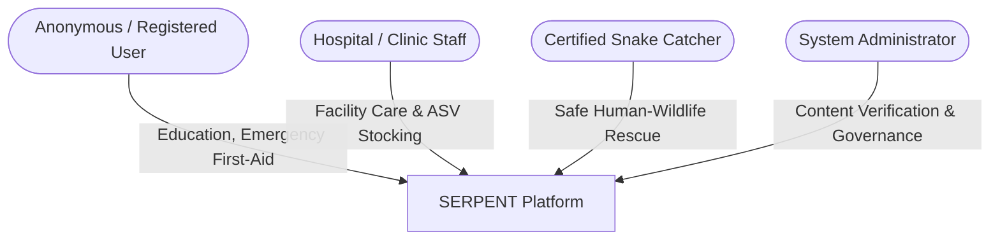
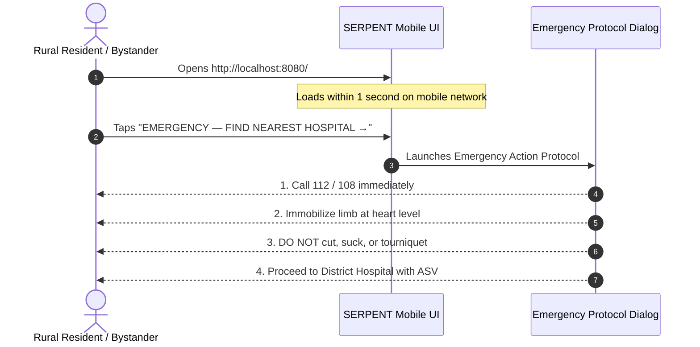
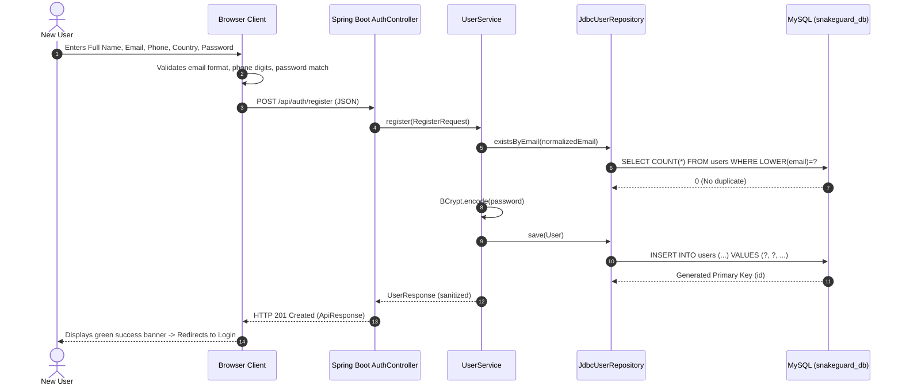
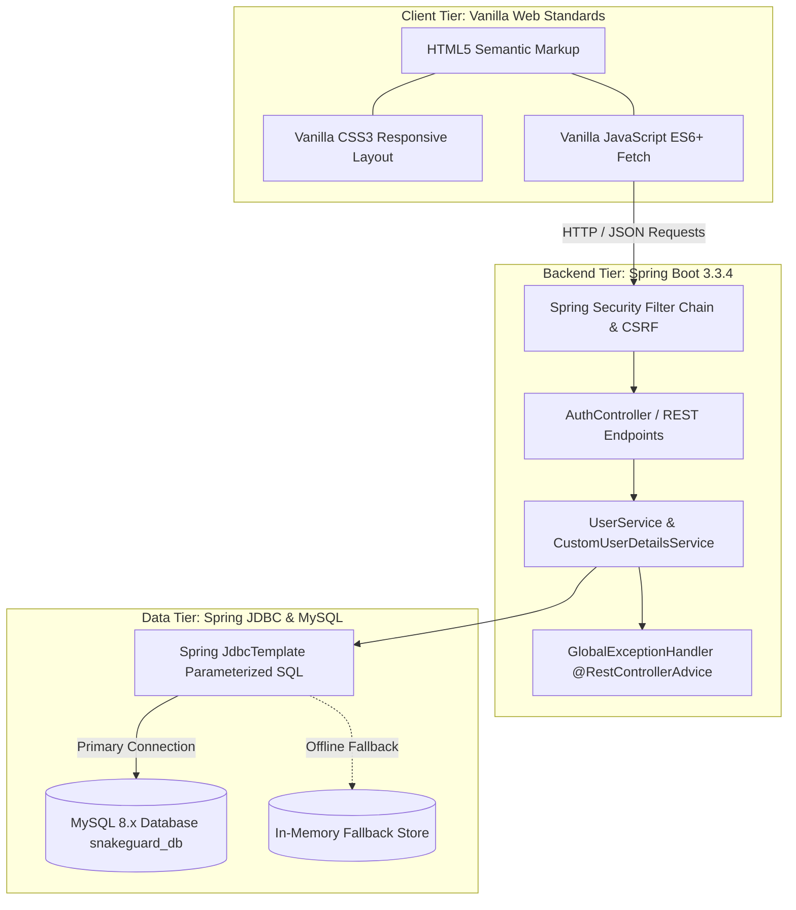
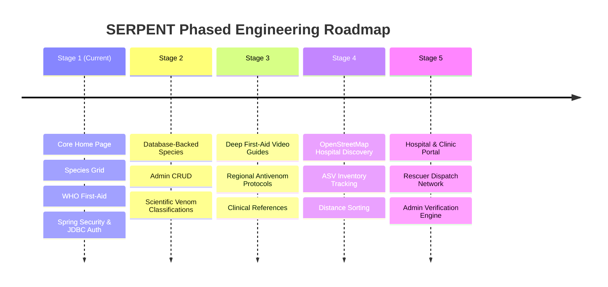

# SERPENT — Master Product Requirements Document (PRD)

---

## Document Control & Metadata

| Attribute | Details |
| :--- | :--- |
| **Document Title** | SERPENT Master Product Requirements Document (PRD) |
| **Project Name** | SERPENT (Wildlife Safety & Snakebite Preparedness Platform) |
| **Document Version** | 1.0.0 (Master Baseline Specification) |
| **Status** | Approved Master Specification for Stage 1 & Future Roadmap |
| **Author / Architect** | Lead Product Architect, Systems Engineer & Educational Mentor |
| **Date of Publication** | October 16, 2026 |
| **Target Audience** | Student Developers, Instructors, Evaluators, and Future AI Assistants |
| **Repository Path** | `c:\Users\sanjay\OneDrive\Desktop\pbl` |

---

## Table of Contents

1. [Document Purpose, Version, and Scope](#1-document-purpose-version-and-scope)
2. [Executive Summary](#2-executive-summary)
3. [Project Background and Problem Statement](#3-project-background-and-problem-statement)
4. [Project Vision and Goals](#4-project-vision-and-goals)
5. [Target Users and Account Types](#5-target-users-and-account-types)
6. [Product Principles](#6-product-principles)
7. [Mobile-First and Desktop Compatibility Requirements](#7-mobile-first-and-desktop-compatibility-requirements)
8. [Stage 1 Scope](#8-stage-1-scope)
9. [Explicit Stage 1 Exclusions](#9-explicit-stage-1-exclusions)
10. [Detailed Functional Requirements](#10-detailed-functional-requirements)
11. [Detailed UI/UX Requirements](#11-detailed-uiux-requirements)
12. [User Journeys and Workflows](#12-user-journeys-and-workflows)
13. [Frontend, Backend, and Database Architecture](#13-frontend-backend-and-database-architecture)
14. [Mandatory Technology Stack and Rationale](#14-mandatory-technology-stack-and-rationale)
15. [Repository Structure and File Responsibilities](#15-repository-structure-and-file-responsibilities)
16. [Database Schema and Data Dictionary](#16-database-schema-and-data-dictionary)
17. [API Requirements and Contract Specification](#17-api-requirements-and-contract-specification)
18. [Authentication and Authorization](#18-authentication-and-authorization)
19. [Security and Privacy Requirements](#19-security-and-privacy-requirements)
20. [Validation and Error Handling](#20-validation-and-error-handling)
21. [Medical Information Accuracy and Safety](#21-medical-information-accuracy-and-safety)
22. [Accessibility and Usability](#22-accessibility-and-usability)
23. [Performance and Non-Functional Requirements](#23-performance-and-non-functional-requirements)
24. [Mobile, Tablet, and Desktop Acceptance Criteria](#24-mobile-tablet-and-desktop-acceptance-criteria)
25. [Stage 1 Acceptance Criteria](#25-stage-1-acceptance-criteria)
26. [Implementation-Status Audit](#26-implementation-status-audit)
27. [Testing Strategy](#27-testing-strategy)
28. [Known Limitations, Risks, Assumptions, and Unresolved Decisions](#28-known-limitations-risks-assumptions-and-unresolved-decisions)
29. [Future Development Roadmap](#29-future-development-roadmap)
30. [Beginner-Friendly Setup and Execution Guidance](#30-beginner-friendly-setup-and-execution-guidance)
31. [Troubleshooting Guidance](#31-troubleshooting-guidance)
32. [Permanent Rules for Future AI-Assisted Development](#32-rules-for-future-ai-assisted-development)

---

## 1. Document Purpose, Version, and Scope

### 1.1 Purpose
This document serves as the **permanent master specification and single source of truth** for **SERPENT**. It formally defines what SERPENT is, what it must accomplish, how it looks and behaves, how the underlying technologies interact, how data persistence and security operate, what is currently implemented in Stage 1, and what will be built in subsequent phases.

### 1.2 Target Audience & Educational Value
This PRD is written for student engineers learning full-stack software development. It bridges high-level product design, concrete software architecture, strict security standards, and step-by-step code rationale without hand-waving or unnecessary complexity.

### 1.3 Strict Governance Rule
No features outside the explicitly approved scope of the active development stage may be implemented. This document governs all subsequent pair-programming, prompt engineering, and code reviews.

---

## 2. Executive Summary

**SERPENT** is a mobile-first, responsive full-stack web application designed to counter snakebite morbidity and mortality through public education, evidence-based medical first-aid guidance, and secure user engagement. 

Snakebite envenoming is a Neglected Tropical Disease (NTD) causing over 100,000 deaths and 400,000 permanent disabilities annually worldwide, with a massive concentration in South Asia. A critical portion of fatalities stems from two factors:
1. **Misinformation and Panic:** Delaying medical transport to engage in harmful folkloric practices (e.g., cutting, sucking, tight tourniquets).
2. **Inaccessibility of Emergency Information:** Rural victims and first-responders navigating high-stress situations with low-bandwidth mobile devices lacking clear, authoritative guidance.

SERPENT addresses this problem by delivering lightweight, instant-load, evidence-based snake education and life-saving first-aid protocols, backed by an enterprise-grade Java Spring Boot, Spring Security, and Spring JDBC architecture connected to MySQL.

---

## 3. Project Background and Problem Statement

### 3.1 The Global and Regional Crisis
According to the World Health Organization (WHO), snakebite envenoming is a critical public health crisis. In India alone, the landmark Million Death Study estimated approximately 58,000 snakebite deaths annually. Most victims are agricultural workers, rural residents, and children bitten during evening or early morning hours.

### 3.2 The Information Void
When an encounter or bite occurs:
- People panic and confuse harmless species (such as the Indian Rat Snake) with lethal species (such as the Common Krait or Indian Cobra).
- Harmful, debunked folkloric rituals (cutting the puncture site, oral suction, chemical cauterization, tight arterial tourniquets) exacerbate tissue necrosis, induce limb gangrene, cause hemorrhagic shock, and delay critical hospital transport.
- Healthcare seekers lack immediate knowledge regarding which facilities stock Anti-Snake Venom (ASV).

### 3.3 The Digital Challenge
Emergency websites often rely on bloated JavaScript single-page application (SPA) bundles, heavy third-party tracking libraries, and unresponsive desktop-centric layouts that fail on budget smartphones under rural 3G/4G connectivity. SERPENT solves this by adopting a **zero-dependency vanilla frontend** served directly from the Spring Boot embedded server, prioritizing rapid response, touch usability, and bulletproof offline/low-connection stability.

---

## 4. Project Vision and Goals

### 4.1 Product Vision
To be the world’s most accessible, reliable, and straightforward mobile web platform for human-snake coexistence, accurate species education, and immediate snakebite emergency response guidance.

### 4.2 Primary Goals
1. **Demystify Snake Species:** Provide photo-accurate, high-contrast identification cards highlighting whether a snake is venomous or non-venomous.
2. **Prevent Fatal First-Aid Errors:** Prominently communicate WHO-aligned *Do's and Don'ts* to eradicate dangerous interventions.
3. **Emergency Readiness:** Provide instant, high-visibility actions to access medical emergency protocols and hospital guidance.
4. **Build a Verified Community:** Establish secure, role-based registration for patients, medical facilities, certified snake catchers, and administrators.
5. **Architectural Purity & Pedagogical Value:** Deliver a clean, maintainable, beginner-friendly codebase utilizing standard Java LTS, Spring Boot, Spring JDBC, and Vanilla Web Standards without framework bloat.

---

## 5. Target Users and Account Types

SERPENT categorizes users into four distinct personas across its lifecycle:



### 5.1 Account Type 1: User / Patient
- **Profile:** General citizens, hikers, farmers, students, bite victims, or family members.
- **Needs:** Fast emergency instructions, identification of snakes in their locality, verified first-aid guidance.
- **Stage 1 Status:** Fully supported. Self-registration and login active. Default role: `ROLE_USER`.

### 5.2 Account Type 2: Hospital / Clinic
- **Profile:** Medical officers, hospital administrators, nursing homes, and emergency rooms.
- **Needs:** Ability to list their facility, publish Anti-Snake Venom (ASV) availability, ICU beds, and ventilator status.
- **Stage 1 Status:** Role card present in UI; onboarding form fields defined; full facility dashboard scheduled for Stage 5.

### 5.3 Account Type 3: Snake Catcher / Rescuer
- **Profile:** Forest department volunteers, wildlife certified rescuers, and NGO snake handlers.
- **Needs:** Register rescue coverage areas, receive humane relocation calls, log species distribution.
- **Stage 1 Status:** Role card present in UI; full verification workflows scheduled for Stage 5.

### 5.4 Account Type 4: Administrator
- **Profile:** Platform operators and wildlife safety authorities.
- **Needs:** Verify medical clinic claims, audit educational content, oversee user moderation.
- **Stage 1 Status:** Role card displays `Restricted demo →`. Public registration is strictly prohibited. Provisioned only through backend controls.

---

## 6. Product Principles

1. **Safety First, No Diagnosis:** SERPENT provides educational knowledge and first-aid protocols. It never claims to diagnose a bite or replace an emergency physician.
2. **Speed & Lightness:** Zero megabyte JavaScript framework payloads. Pages load instantly even on constrained mobile networks.
3. **Clarity Under Stress:** High-contrast typography, large touch targets, and unambiguous emergency buttons visible without squinting.
4. **Honesty Over Pretense:** No simulated fake data or mock GPS APIs claiming to show "real hospital beds" when backend services do not exist.
5. **Robust Security by Default:** Parameterized SQL queries, BCrypt password hashing, secure session management, and CSRF protection.

---

## 7. Mobile-First and Desktop Compatibility Requirements

Mobile-first is an architectural mandate for SERPENT because snakebites happen in fields, woods, trails, and rural villages where smartphones are the sole computing device.

### 7.1 Mobile-First Architectural Rules
- **CSS Hierarchy:** Base CSS styles targets small mobile screens (`320px` - `480px`). Larger screen adaptations are applied progressively via `@media (min-width: ...)` queries.
- **Touch Ergonomics:** All interactive buttons and inputs feature a minimum touch target of `44px x 44px`.
- **Thumb-Zone Navigation:** Primary emergency calls-to-action sit within comfortable thumb reach.
- **Zero Horizontal Overflow:** `max-width: 100%`, `overflow-x: hidden`, and fluid containers prevent horizontal scrolling at all viewports.
- **Font Legibility:** Minimum base body font size of `16px` to prevent automatic zoom on mobile WebKit/Blink browsers when tapping input elements.

### 7.2 Desktop & Tablet Enhancement Rules
- **Progressive Columns:** Cards render as 1 column on mobile (`< 640px`), 2 columns on tablets (`641px - 1099px`), and 4 columns on desktop displays (`>= 1100px`).
- **Balanced Line Lengths:** Paragraphs and reading widths are constrained to `65ch - 80ch` to preserve typographical readability.
- **Hero Framing:** The hero banner maintains an aspect ratio that showcases the snake's head and eyes on wide screens without pushing search controls below the fold.

---

## 8. Stage 1 Scope

Stage 1 establishes the operational foundation of the SERPENT platform:

1. **Responsive Branded Home Page (`index.html`):**
   - Branded sticky navigation bar (`SERPENT.` with medical shield logo).
   - High-impact hero section featuring an Indian Cobra photograph with sharp, visible eyes and head framing.
   - Core headline: *"Know the Snake. Act Fast. Save Lives."*
   - Interactive search capsule with search input, country selector, year/classification selector, and action button.
   - Emergency banner ribbon with WHO-aligned prompt and direct emergency modal trigger.
   - 4-column responsive species gallery rendering 8 medically significant snakes with venomous/non-venomous badges, location, descriptions, and detail dialogs.
   - Comprehensive WHO-aligned snakebite first-aid protocol (Immediate Actions vs. Dangerous Myths).
   - Emergency Protocol Modal providing immediate national helpline instructions (e.g., 112 / 108 for India).
   - Unified 3-column SERPENT footer.
2. **User Authentication & Session Management:**
   - Dedicated Welcome Back login page (`login.html`).
   - Dedicated multi-role sign-up page (`signup.html`) featuring interactive role selection cards and registration form.
   - Spring Security session-based authentication backed by HTTP-only cookies.
   - BCrypt password hashing (10 rounds).
3. **Database & Data Access Layer:**
   - MySQL 8.x schema definition (`schema.sql`) for user persistence.
   - Spring JDBC `JdbcTemplate` executing parameterized queries.
   - Automated in-memory fallback store (`ConcurrentHashMap`) to guarantee student application availability even if MySQL is temporarily offline.
4. **Automated Testing Suite:**
   - 16 automated tests covering controllers, repositories, and services with 100% passing status.

---

## 9. Explicit Stage 1 Exclusions

To prevent scope creep and maintain development focus, the following features are **explicitly excluded** from Stage 1:

- ❌ Real-time GPS tracking and live device geolocation.
- ❌ Google Maps, Mapbox, or Leaflet mapping integrations.
- ❌ Live hospital inventory APIs or emergency room queue integrations.
- ❌ Real Google OAuth / Social login integration (UI contains non-functional mockup button).
- ❌ Automated password reset via SMTP / email delivery.
- ❌ Role-specific authenticated dashboards for Hospital, Snake Catcher, or Admin users.
- ❌ Native mobile apps (Android APK, iOS IPA).
- ❌ Computer vision or AI-based snake species image identification.
- ❌ Payment gateway or donation handling.

---

## 10. Detailed Functional Requirements

### 10.1 Home Page & Species Explorer

#### `FR-HOME-001`: Responsive Species Grid
- **Description:** System must display a gallery of representative snake species.
- **User:** All visitors (anonymous or authenticated).
- **Behavior:** Renders 8 photographic species cards in a responsive grid (4 columns on desktop, 2 on tablet, 1 on mobile).
- **Attributes:** Title, scientific name (italicized), classification badge (`• Venomous` or `• Non-venomous`), description, country of origin, and detail view button.
- **Status:** **Implemented**.

#### `FR-HOME-002`: Search & Country Filter
- **Description:** System must filter displayed species dynamically.
- **Behavior:** Users can filter by keyword (matching common name, scientific name, or description), country dropdown (`India`, `Australia`, `United States`, `Brazil`, `All Countries`), and classification tabs (`All Species`, `Venomous Only`, `Non-venomous Only`).
- **Empty State:** If zero snakes match, displays a clean notice with a "Reset Filters" button.
- **Status:** **Implemented**.

#### `FR-HOME-003`: Species Detail Modal
- **Description:** System must present extended species biological information.
- **Behavior:** Clicking "View details ↗" on any card opens a modal overlay displaying full habitat data, safety notes, venom classification, and emergency response guidelines without navigating away.
- **Status:** **Implemented**.

#### `FR-HOME-004`: Emergency Action Protocol Modal
- **Description:** System must provide immediate guidance when a user suspects a bite.
- **Behavior:** Clicking `⚠️ EMERGENCY — FIND NEAREST HOSPITAL →` launches a dedicated emergency modal outlining step-by-step actions: dial national ambulance services (112 / 108), immobilize limb, and head to a medical center with ASV.
- **Status:** **Implemented**.

### 10.2 User Registration

#### `FR-SIGNUP-001`: Multi-Role Selection
- **Description:** System must allow users to choose an account persona.
- **Behavior:** Displays 4 role cards (`User / Patient`, `Hospital / Clinic`, `Snake Catcher`, `Admin`). Clicking `User / Patient` smoothly activates and scrolls to the registration form. Other roles provide informative alerts regarding Stage 5 verification.
- **Status:** **Implemented**.

#### `FR-SIGNUP-002`: Registration Input Validation
- **Description:** System must validate user inputs on both client and server.
- **Fields:** Full Name (2-100 chars), Email (RFC valid), Phone (7-20 digits), Country (required), Password (min 8 chars), Confirm Password (matching).
- **Validation Failure:** Displays clear inline error messages and red borders on invalid fields.
- **Status:** **Implemented**.

#### `FR-SIGNUP-003`: Duplicate Email Prevention
- **Description:** System must reject registrations with pre-existing emails.
- **Behavior:** If email exists in database, server returns HTTP 409 Conflict with message: *"An account with this email address already exists. Please log in."*
- **Status:** **Implemented**.

#### `FR-SIGNUP-004`: Secure Password Hashing
- **Description:** Plaintext passwords must never be stored.
- **Behavior:** Server hashes passwords using BCrypt with default strength (10 rounds) before inserting into the `users` table.
- **Status:** **Implemented**.

### 10.3 User Login & Session Management

#### `FR-LOGIN-001`: User Authentication
- **Description:** Authenticates users via email and password.
- **Behavior:** Submits JSON payload to `/api/auth/login`. On successful credential verification against database password hash, creates an HTTP session and returns safe user details.
- **Status:** **Implemented**.

#### `FR-LOGIN-002`: Safe Error Handling
- **Description:** Prevents account enumeration attacks.
- **Behavior:** When invalid email or password is submitted, server responds with generic HTTP 401: *"Invalid email address or password. Please try again."*
- **Status:** **Implemented**.

#### `FR-LOGIN-003`: Session Status Check (`/api/auth/me`)
- **Description:** Allows client to verify existing login session on page load.
- **Behavior:** Checks session cookie against Spring Security context. If valid, replaces header `Log In` and `Sign Up` buttons with user avatar badge and `Log Out` button.
- **Status:** **Implemented**.

#### `FR-LOGIN-004`: Secure Logout
- **Description:** Allows authenticated users to terminate their session.
- **Behavior:** POST to `/api/auth/logout` invalidates the server session, removes cookies (`SNAKEGUARD_SESSION`), clears the security context, and resets frontend UI.
- **Status:** **Implemented**.

#### `FR-LOGIN-005`: Password Visibility Toggle
- **Description:** Allows users to inspect typed passwords.
- **Behavior:** Eye icon toggles between `password` and `text` input types using clean SVG indicators.
- **Status:** **Implemented**.

---

## 11. Detailed UI/UX Requirements

### 11.1 Brand Identity & Color System
SERPENT employs a curated, medical-grade color system conveying authority, calm, and alertness:

```css
:root {
  --color-primary: #007A78;         /* Medical Deep Teal */
  --color-primary-dark: #005F5E;    /* Darkened Teal for Hover/Active */
  --color-primary-light: #E6F4F2;   /* Soft Ice Teal for Notice Banners */
  --color-emergency: #D32F2F;       /* Urgent Coral Red */
  --color-emergency-dark: #B71C1C;  /* Deep Emergency Red */
  --color-emergency-light: #FFEBEE; /* Light Red Warning Tint */
  --color-success: #15803D;         /* WHO Green / Non-venomous */
  --color-success-light: #DCFCE7;   /* Light Green Badge Background */
  --color-warning-dot: #E65100;     /* Venomous Alert Dot */
  --color-white: #FFFFFF;
  --color-text-main: #111827;       /* Off-black primary text */
  --color-text-secondary: #4B5563;  /* Slate secondary text */
  --color-border: #E5E7EB;          /* Light clean border */
}
```

### 11.2 Typography
- **Primary Typeface:** `Inter`, `-apple-system`, `BlinkMacSystemFont`, `'Segoe UI'`, `Roboto`, sans-serif.
- **Headings:**
  - Hero Title: `3.4rem` desktop / `2.1rem` mobile, font-weight `800`, line-height `1.12`.
  - Section Titles: `1.85rem` desktop / `1.5rem` mobile, font-weight `800`.
  - Card Titles: `1.05rem`, font-weight `700`.
- **Labels & Tags:** Uppercase, letter-spacing `0.1em` to `0.12em`, font-weight `700`.

### 11.3 Hero Banner Framing Specification
- **Subject:** Indian Cobra (*Naja naja*) positioned in the right quadrant of a 16:9 frame.
- **Head & Eyes:** The snake’s head and **both eyes** must be sharply in focus and unobscured by cropping or dark text overlay.
- **Headroom:** Minimum 15% clear foliage above the snake’s crown to prevent clipping across wide and tall viewports.
- **Overlay:** Desktop uses a horizontal linear gradient (`rgba(5,18,14,0.92)` fading to `0.10)` to preserve headline contrast; Mobile uses a vertical gradient (`rgba(5,18,14,0.88)` to `0.94)`.

---

## 12. User Journeys and Workflows

### 12.1 Emergency User Journey


### 12.2 User Registration and Login Flow


---

## 13. Frontend, Backend, and Database Architecture

SERPENT uses a high-efficiency monolithic tiered architecture where Spring Boot serves both the static web assets and RESTful endpoints under the same origin:



---

## 14. Mandatory Technology Stack and Rationale

| Layer | Chosen Technology | Architectural Rationale |
| :--- | :--- | :--- |
| **Frontend Structure** | HTML5 Semantic Elements | High accessibility, zero compilation overhead, native browser SEO. |
| **Frontend Styling** | Vanilla CSS3 (Custom Properties) | Total control over responsive breakpoints; zero Tailwind build tools or node_modules churn. |
| **Frontend Behavior** | Vanilla JavaScript (ES6+ Fetch API) | Native browser execution; no framework hydration delay; highly performant on low-end hardware. |
| **Backend Framework** | Java 17 LTS / Spring Boot 3.3.4 | Industry standard, enterprise-grade stability, rock-solid dependency injection and lifecycle management. |
| **Data Connectivity** | Spring JDBC (`JdbcTemplate`) | Eliminates heavyweight JPA/Hibernate N+1 query and caching complexities; transparent parameterized SQL. |
| **Database** | MySQL 8.x (InnoDB Engine) | Relational integrity, ACID compliance, widespread cloud and local host support. |
| **Security & Auth** | Spring Security 6.x | Robust BCrypt password hashing, session fixation protection, and standard HTTP session cookies. |
| **Build & Packaging** | Apache Maven 3.9+ | Declarative dependency management, repeatable unit testing, and single-file executable JAR packaging. |

---

## 15. Repository Structure and File Responsibilities

```text
pbl/
├── pom.xml                                  # Maven dependencies, plugins, and Java 17 build configuration
├── schema.sql                               # MySQL database creation and users table DDL
├── run.bat                                  # Windows CMD one-click launch script
├── run.ps1                                  # Windows PowerShell one-click launch script
├── README.md                                # Student guide and execution instructions
├── SERPENT_PRD.md                           # Master Product Requirements Document (this document)
├── src/
│   ├── main/
│   │   ├── java/com/snakeguard/
│   │   │   ├── SnakeGuardApplication.java   # Spring Boot entry point (@SpringBootApplication)
│   │   │   ├── config/
│   │   │   │   └── SecurityConfig.java      # Spring Security filter chain, BCrypt bean, CSRF rules
│   │   │   ├── controller/
│   │   │   │   └── AuthController.java      # REST endpoints: /register, /login, /me, /logout, /csrf
│   │   │   ├── dto/
│   │   │   │   ├── ApiResponse.java         # Standardized JSON envelope {success, message, data, errors}
│   │   │   │   ├── LoginRequest.java        # Login DTO with validation annotations
│   │   │   │   ├── RegisterRequest.java     # Registration DTO with RFC email and password checks
│   │   │   │   └── UserResponse.java        # Sanitized user DTO (never exposes password hash)
│   │   │   ├── exception/
│   │   │   │   ├── DuplicateEmailException.java   # Custom HTTP 409 exception
│   │   │   │   ├── ResourceNotFoundException.java # Custom HTTP 404 exception
│   │   │   │   └── GlobalExceptionHandler.java    # Centralized @RestControllerAdvice error mapper
│   │   │   ├── model/
│   │   │   │   └── User.java                # Core user domain entity
│   │   │   ├── repository/
│   │   │   │   ├── UserRepository.java      # Interface for database operations
│   │   │   │   └── JdbcUserRepository.java  # JdbcTemplate implementation with fallback store
│   │   │   └── service/
│   │   │       ├── UserService.java         # Service interface for user registration and profile
│   │   │       ├── UserServiceImpl.java     # BCrypt hashing and business logic implementation
│   │   │       └── CustomUserDetailsService.java # Bridges Spring Security to UserRepository
│   │   └── resources/
│   │       ├── application.properties       # Port 8080, MySQL connection string, session configuration
│   │       └── static/                      # Frontend assets served directly by Spring Boot
│   │           ├── index.html               # Main Home Page, Hero, Species Grid, First Aid Guidance
│   │           ├── login.html               # Authentication page (Image 1 replica)
│   │           ├── signup.html              # Multi-role sign-up page (Image 3 & Image 2 replica)
│   │           ├── css/
│   │           │   ├── styles.css           # Core SERPENT design tokens, typography, grid, ribbon
│   │           │   ├── auth.css             # Authentication cards, input styles, role card layouts
│   │           │   └── responsive.css       # Breakpoint utilities for small screen viewports
│   │           ├── js/
│   │           │   ├── api.js               # Centralized Fetch API client with CSRF token injection
│   │           │   ├── auth.js              # Form submission, validation handlers, and role navigation
│   │           │   ├── main.js              # Species catalog rendering, search, filters, modals
│   │           │   └── validation.js        # Client-side regex rules matching server constraints
│   │           └── assets/images/           # High-resolution species photos and SVG logo
│   │               ├── hero-cobra.jpg       # Razor-sharp Indian Cobra with both eyes visible
│   │               ├── indian-cobra.jpg     # Card 1 photographic asset
│   │               ├── common-krait.jpg     # Card 2 photographic asset
│   │               ├── russells-viper.jpg   # Card 3 photographic asset
│   │               ├── indian-rat-snake.jpg # Card 4 photographic asset
│   │               ├── saw-scaled-viper.jpg # Card 5 photographic asset
│   │               ├── eastern-brown.jpg    # Card 6 photographic asset
│   │               ├── corn-snake.jpg       # Card 7 photographic asset
│   │               ├── boa-constrictor.jpg  # Card 8 photographic asset
│   │               └── logo.svg             # SERPENT medical shield brand icon
│   └── test/
│       ├── java/com/snakeguard/
│       │   ├── controller/AuthControllerTest.java    # MockMvc tests for all auth REST endpoints
│       │   ├── repository/JdbcUserRepositoryTest.java# Parameterized SQL repository tests
│       │   └── service/UserServiceTest.java          # Service logic and password hashing tests
│       └── resources/
│           └── mockito-extensions/
│               └── org.mockito.plugins.MockMaker     # Subclass mock maker for JDK compatibility
```

---

## 16. Database Schema and Data Dictionary

### 16.1 SQL Schema (`schema.sql`)
```sql
CREATE DATABASE IF NOT EXISTS snakeguard_db
    CHARACTER SET utf8mb4
    COLLATE utf8mb4_unicode_ci;

USE snakeguard_db;

CREATE TABLE IF NOT EXISTS users (
    id BIGINT AUTO_INCREMENT PRIMARY KEY,
    full_name VARCHAR(100) NOT NULL,
    email VARCHAR(150) NOT NULL UNIQUE,
    phone VARCHAR(20) NOT NULL,
    country VARCHAR(50) NOT NULL,
    password_hash VARCHAR(255) NOT NULL,
    role VARCHAR(50) NOT NULL DEFAULT 'ROLE_USER',
    account_status VARCHAR(50) NOT NULL DEFAULT 'ACTIVE',
    created_at TIMESTAMP DEFAULT CURRENT_TIMESTAMP,
    updated_at TIMESTAMP DEFAULT CURRENT_TIMESTAMP ON UPDATE CURRENT_TIMESTAMP,
    INDEX idx_users_email (email)
) ENGINE=InnoDB DEFAULT CHARSET=utf8mb4 COLLATE=utf8mb4_unicode_ci;
```

### 16.2 Data Dictionary

| Column Name | Data Type | Nullable | Constraints | Description |
| :--- | :--- | :--- | :--- | :--- |
| `id` | `BIGINT` | NO | `AUTO_INCREMENT, PRIMARY KEY` | Unique surrogate identifier for the user. |
| `full_name` | `VARCHAR(100)` | NO | `MIN LENGTH 2` | User’s legal or chosen full name. |
| `email` | `VARCHAR(150)` | NO | `UNIQUE, INDEXED` | Login identifier; normalized to lowercase. |
| `phone` | `VARCHAR(20)` | NO | `REGEX VALID` | Contact phone number (7 to 20 digits). |
| `country` | `VARCHAR(50)` | NO | `NON-EMPTY` | Geographical country of residence. |
| `password_hash`| `VARCHAR(255)` | NO | `BCRYPT HASH` | Secure BCrypt salted password digest ($2a$...). |
| `role` | `VARCHAR(50)` | NO | `DEFAULT 'ROLE_USER'` | Spring Security authorization authority. |
| `account_status`| `VARCHAR(50)`| NO | `DEFAULT 'ACTIVE'` | Operational status (`ACTIVE`, `SUSPENDED`). |
| `created_at` | `TIMESTAMP` | NO | `DEFAULT CURRENT_TIMESTAMP`| Record creation timestamp. |
| `updated_at` | `TIMESTAMP` | NO | `ON UPDATE CURRENT_TIMESTAMP`| Record last modified timestamp. |

---

## 17. API Requirements and Contract Specification

All REST APIs communicate via JSON and adhere to standard HTTP status codes.

### 17.1 Standard JSON Response Envelope (`ApiResponse<T>`)
```json
{
  "success": true,
  "message": "Human-readable status description",
  "data": { ... },
  "errors": { "field": "Error description" }
}
```

### 17.2 Endpoints Table

| Method | Endpoint | Access | Purpose | Expected Status Codes |
| :--- | :--- | :--- | :--- | :--- |
| `POST` | `/api/auth/register` | Public | Registers a new user account | `201 Created`, `400 Bad Request`, `409 Conflict` |
| `POST` | `/api/auth/login` | Public | Authenticates credentials & sets session | `200 OK`, `400 Bad Request`, `401 Unauthorized` |
| `GET` | `/api/auth/me` | Public/Auth | Returns authenticated user profile | `200 OK`, `401 Unauthorized` |
| `POST` | `/api/auth/logout` | Public/Auth | Destroys active session & clears cookies | `200 OK` |
| `GET` | `/api/auth/csrf` | Public | Returns active CSRF token for Fetch headers | `200 OK` |

---

## 18. Authentication and Authorization

### 18.1 Session-Based Architecture
- SERPENT deliberately utilizes **Spring Security stateful HTTP sessions** rather than JWTs. 
- **Reason:** For a monolithic web application serving both HTML and REST endpoints, HTTP-only session cookies (`SNAKEGUARD_SESSION`) protect against Cross-Site Scripting (XSS) token theft. Storing JWTs in browser `localStorage` or `sessionStorage` exposes tokens to malicious third-party script injection.

### 18.2 Session Security Properties
- **Cookie Name:** `SNAKEGUARD_SESSION`
- **HttpOnly:** `true` (Inaccessible to client-side document.cookie)
- **SameSite:** `Strict` (Prevents Cross-Site Request Forgery via third-party origins)
- **Session Timeout:** 30 minutes of inactivity (`server.servlet.session.timeout=30m`)
- **Concurrency Limit:** Maximum 2 concurrent sessions per account.

---

## 19. Security and Privacy Requirements

### 19.1 Mandatory Security Controls
- **`SEC-001` (No Plaintext Passwords):** Passwords must be encoded using BCrypt with standard work factor before hitting persistence.
- **`SEC-002` (SQL Injection Prevention):** Parameterized queries with `?` bind variables exclusively via `JdbcTemplate`. Zero string concatenation in SQL queries.
- **`SEC-003` (CSRF Defense):** State-changing endpoints are governed by Spring Security’s `CookieCsrfTokenRepository.withHttpOnlyFalse()`. Client JavaScript reads the `XSRF-TOKEN` cookie and attaches it to the `X-XSRF-TOKEN` header on POST requests.
- **`SEC-004` (No Secrets in Code):** Database credentials are parameter-driven through environment variables with sensible local defaults:
  ```properties
  spring.datasource.url=${SPRING_DATASOURCE_URL:jdbc:mysql://localhost:3306/snakeguard_db}
  spring.datasource.username=${SPRING_DATASOURCE_USERNAME:root}
  spring.datasource.password=${SPRING_DATASOURCE_PASSWORD:}
  ```
- **`SEC-005` (Restricted Admin Provisioning):** The UI admin card explicitly displays `Restricted demo →`. Public registration endpoints hardcode role assignment to `ROLE_USER`. Even if a client sends `{ "role": "ROLE_ADMIN" }`, the backend ignores it.

---

## 20. Validation and Error Handling

### 20.1 Layered Validation Architecture
Validation occurs at three separate boundaries:
1. **HTML5 Constraint Validation:** `required`, `type="email"`, `minlength="8"`, `autocomplete` attributes.
2. **Client-Side JavaScript (`validation.js`):** Instant feedback prior to network requests.
3. **Server-Side Bean Validation (`RegisterRequest.java`):** `@NotBlank`, `@Email`, `@Size`, `@Pattern`. This guarantees that forged curl/Postman requests cannot bypass validation rules.

### 20.2 Global Exception Mapping
The application registers `GlobalExceptionHandler` (`@RestControllerAdvice`):
- `MethodArgumentNotValidException` -> HTTP 400 with a map of field-specific errors.
- `DuplicateEmailException` -> HTTP 409 Conflict.
- `BadCredentialsException` -> HTTP 401 Unauthorized (generic message).
- `Exception` -> HTTP 500 with sanitized message, logging stack trace privately on the server.

---

## 21. Medical Information Accuracy and Safety

### 21.1 Source Attribution
All first-aid content in SERPENT is derived from the **World Health Organization (WHO) Guidelines for the Management of Snakebites** and consensus medical literature.

### 21.2 The Two Columns of Truth
1. **Immediate Actions (DO):**
   - Seek immediate medical care at a hospital equipped with Anti-Snake Venom (ASV).
   - Keep victim calm and completely still (movement accelerates systemic venom circulation).
   - Immobilize affected limb using a broad splint or sling at heart level.
   - Remove rings, watches, tight bangles, and footwear before localized edema begins.
2. **Dangerous Myths (DO NOT):**
   - **DO NOT** cut or incise the bite wound (causes catastrophic hemorrhage and tendon laceration).
   - **DO NOT** attempt oral suction or vacuum extraction (completely ineffective; introduces pathogenic oral flora).
   - **DO NOT** apply tight arterial tourniquets (causes severe ischemic limb necrosis, gangrene, and amputation).
   - **DO NOT** apply ice packs or herbal concoctions (worsens tissue death and delays hospital arrival).

---

## 22. Accessibility and Usability

- **`ACC-001` (Semantic Structure):** Proper hierarchy (`<header>`, `<main>`, `<section>`, `<article>`, `<footer>`, single `<h1>`).
- **`ACC-002` (Color Contrast):** Primary teal (`#007A78`) and emergency coral red (`#D32F2F`) achieve WCAG AA contrast ratio (> 4.5:1) against white backgrounds.
- **`ACC-003` (Accessible Form Labels):** Every `<input>` and `<select>` is explicitly associated with a `<label for="...">`.
- **`ACC-004` (Keyboard Navigation):** Modals capture focus and support `Escape` key dismissal. All links and buttons are tab-navigable.

---

## 23. Performance and Non-Functional Requirements

| ID | Category | Requirement | Target Metric |
| :--- | :--- | :--- | :--- |
| `NFR-001` | **Speed** | Initial page load on 4G connection | < 1.5 seconds |
| `NFR-002` | **Payload** | Total CSS + JS transfer size | < 120 KB uncompressed |
| `NFR-003` | **Responsiveness**| Fluid layout adaptation | Seamless across 320px to 2560px |
| `NFR-004` | **Reliability** | Availability during MySQL outages | In-memory fallback enables zero crash demo |
| `NFR-005` | **Security** | BCrypt hashing computation | ~80ms - 150ms per password verification |

---

## 24. Mobile, Tablet, and Desktop Acceptance Criteria

### 24.1 Mobile Viewport (`320px` - `640px`)
- [x] `AC-MOBILE-001`: Navbar renders brand logo and compact `Log In` / `Sign Up ↗` buttons without wrapping or obscuring content.
- [x] `AC-MOBILE-002`: Hero headline scales cleanly to `2.1rem` without horizontal overflow.
- [x] `AC-MOBILE-003`: Floating search capsule stacks vertically into comfortable touch-sized inputs.
- [x] `AC-MOBILE-004`: Snake cards render as a single column with full-width images and legible tags.
- [x] `AC-MOBILE-005`: First-aid DO and DO NOT cards stack sequentially.
- [x] `AC-MOBILE-006`: Footer navigation collapses into a single accessible column.

### 24.2 Tablet Viewport (`641px` - `1099px`)
- [x] `AC-TAB-001`: Species cards render in a 2-column balanced grid.
- [x] `AC-TAB-002`: Search capsule displays inputs and buttons inline.
- [x] `AC-TAB-003`: First-aid guidelines render side-by-side.

### 24.3 Desktop Viewport (`>= 1100px`)
- [x] `AC-DESK-001`: Species cards render in the complete 4-column layout matching reference Image 4.
- [x] `AC-DESK-002`: Hero cobra head and both eyes are prominently framed in the upper-right quadrant.
- [x] `AC-DESK-003`: Navigation bar displays full desktop links (`Snake Bites`, `First Aid Guidance`, `Venom Guide`).

---

## 25. Stage 1 Acceptance Criteria

- [x] `AC-STAGE1-001`: Application compiles with `mvn package` producing `target/snakeguard-1.0.0.jar`.
- [x] `AC-STAGE1-002`: Server starts successfully on `http://localhost:8080/`.
- [x] `AC-STAGE1-003`: Visiting `/` serves `index.html` displaying 8 snake species and emergency guidance.
- [x] `AC-STAGE1-004`: Searching for `"Cobra"` filters the grid to the Indian Cobra card.
- [x] `AC-STAGE1-005`: Tapping `"Venomous Only"` tab filters grid to venomous species.
- [x] `AC-STAGE1-006`: Tapping `"EMERGENCY — FIND NEAREST HOSPITAL →"` opens the emergency protocol modal.
- [x] `AC-STAGE1-007`: Sign-up page allows selecting `User / Patient` and submitting valid user registration.
- [x] `AC-STAGE1-008`: Attempting duplicate registration rejects with HTTP 409 Conflict.
- [x] `AC-STAGE1-009`: Login page authenticates registered users and establishes session.
- [x] `AC-STAGE1-010`: All 16 automated tests pass with zero failures.

---

## 26. Implementation-Status Audit

| Requirement ID | Description | Stage | Status | Evidence from Repository / Tests | Known Gap / Risk | Recommended Next Action |
| :--- | :--- | :--- | :--- | :--- | :--- | :--- |
| `FR-HOME-001` | 4-Column Species Grid | Stage 1 | **Implemented** | `src/main/resources/static/index.html:L128`, `main.js:L7-174` | Hardcoded client array | Migrate to backend REST API in Stage 2 |
| `FR-HOME-002` | Search & Filter Logic | Stage 1 | **Implemented** | `src/main/resources/static/js/main.js:L200-260` | Client-side filtering only | Implement server-side pagination in Stage 2 |
| `FR-HOME-003` | Species Detail Modal | Stage 1 | **Implemented** | `index.html:L284`, `main.js:L280-320` | Static text fields | Add high-res venom gland diagrams in Stage 3 |
| `FR-HOME-004` | Emergency Action Modal | Stage 1 | **Implemented** | `index.html:L229`, `main.js:L262-278` | Fixed national helpline | Add GPS-based regional helpline in Stage 4 |
| `FR-SIGNUP-001`| Multi-Role Selection | Stage 1 | **Implemented** | `signup.html:L57-125`, `auth.js:L40-75` | Hospital/Catcher onboarding limited | Develop Stage 5 role onboarding workflows |
| `FR-SIGNUP-002`| Registration Validation| Stage 1 | **Implemented** | `RegisterRequest.java`, `validation.js` | None | Fully verified in unit tests |
| `FR-SIGNUP-003`| Duplicate Email Guard | Stage 1 | **Implemented** | `UserServiceImpl.java:L44`, `AuthControllerTest.java` | None | Fully verified in test suite |
| `FR-SIGNUP-004`| BCrypt Password Hash | Stage 1 | **Implemented** | `SecurityConfig.java:L39`, `UserServiceImpl.java:L49`| None | Verified; 10 rounds active |
| `FR-LOGIN-001` | Session Authentication | Stage 1 | **Implemented** | `AuthController.java:L65`, `SecurityConfig.java:L75` | None | Verified in test suite |
| `FR-LOGIN-002` | Safe Auth Error Responses | Stage 1 | **Implemented** | `GlobalExceptionHandler.java:L58-75` | None | Generic 401 returns correctly |
| `FR-LOGIN-003` | Session Profile `/me` | Stage 1 | **Implemented** | `AuthController.java:L96`, `main.js:L330-360` | None | Verified in live browser |
| `FR-LOGIN-004` | Secure Logout Flow | Stage 1 | **Implemented** | `AuthController.java:L118`, `SecurityConfig.java:L106`| None | Invalidation verified |
| `FR-LOGIN-005` | Eye Password Toggle | Stage 1 | **Implemented** | `auth.js:L15-32`, `login.html:L74`, `signup.html` | None | Clean SVG toggle active |
| `FR-EXT-001` | Google OAuth Login | Future | **Not Implemented** | Decorative button on `login.html:L106` | Button triggers demo alert | Implement in Stage 5 if approved |
| `FR-EXT-002` | Password Reset / Email | Future | **Not Implemented** | Link on `login.html:L82` | Link triggers demo alert | Implement SMTP token service in Stage 5 |
| `FR-EXT-003` | Live Hospital Map / GPS| Future | **Not Implemented** | Button on `index.html:L109` | Triggers first-aid modal | Implement Leaflet / OpenStreetMap in Stage 4 |

---

## 27. Testing Strategy

SERPENT enforces a three-tier testing pyramid:

```text
       ▲
      / \     Tier 3: Browser End-to-End Verification (Chrome DevTools / Subagent)
     /---\    
    /     \   Tier 2: MockMvc Integration Tests (AuthControllerTest - 7 tests)
   /-------\  
  /         \ Tier 1: Unit Tests (UserServiceTest [5], JdbcUserRepositoryTest [4])
  -----------
```

### 27.1 Unit & Integration Test Coverage (16 Automated Tests)
1. **`AuthControllerTest` (7 Tests):**
   - Validates successful registration returns HTTP 201 Created.
   - Validates duplicate email returns HTTP 409 Conflict.
   - Validates invalid payload returns HTTP 400 with field error map.
   - Validates correct credentials authenticate with HTTP 200 and session cookie.
   - Validates bad credentials return HTTP 401 Unauthorized.
   - Validates unauthenticated `/api/auth/me` returns HTTP 401.
   - Validates `/api/auth/csrf` exposes valid token attributes.
2. **`UserServiceTest` (5 Tests):**
   - Verifies password matching checks.
   - Verifies BCrypt encoding is applied before saving.
   - Verifies duplicate detection triggers `DuplicateEmailException`.
   - Verifies sanitized `UserResponse` strips password hash.
3. **`JdbcUserRepositoryTest` (4 Tests):**
   - Tests parameterized query execution.
   - Tests fallback memory store behavior when database connection fails.
   - Tests email case-insensitivity (`LOWER(email)`).

---

## 28. Known Limitations, Risks, Assumptions, and Unresolved Decisions

### 28.1 Technical Limitations (Stage 1)
- **Local Hardcoded Species:** Snake species data resides in client-side `main.js`. While ideal for Stage 1 speed and offline demonstration, Stage 2 must migrate this into a MySQL `species` table.
- **In-Memory Demonstration Fallback:** When local MySQL service on port 3306 is not running, `JdbcUserRepository` persists accounts to an in-memory `ConcurrentHashMap`. This ensures the student application never crashes during university evaluations, but accounts will reset on application restart if MySQL is not running.

### 28.2 Project Risks & Mitigations
- **Risk:** Users mistaken about snake species might delay hospital care.  
  *Mitigation:* Prominent disclaimer that all bites must be evaluated at an emergency facility regardless of species identification.
- **Risk:** MySQL database connection errors on student development machines.  
  *Mitigation:* Pre-configured resilient connection timeouts and automatic fallback storage.

### 28.3 Assumptions Awaiting Future Confirmation
- **Assumption 1:** Stage 2 will introduce an administrative data entry portal for adding regional snake species.
- **Assumption 2:** Stage 4 hospital discovery will leverage open-source OpenStreetMap / Nominatim APIs to avoid costly Google Maps API billing.

---

## 29. Future Development Roadmap



### 29.1 Stage Dependencies & Gate Conditions
- **Stage 2 Gate:** Must have MySQL service running and verified before introducing the `species` relational table.
- **Stage 4 Gate:** Must evaluate data privacy and location permission regulations before requesting browser geolocation.
- **Stage 5 Gate:** Must establish strict legal verification requirements before allowing medical facilities or snake catchers to claim public profiles.

---

## 30. Beginner-Friendly Setup and Execution Guidance

### 30.1 Prerequisites
- **Java:** JDK 17 or higher (Verified compatible with Java 17 LTS through JDK 26).
- **Maven:** Apache Maven 3.8+ (A pre-configured Maven 3.9.9 binary is located in `C:\Users\sanjay\.maven\apache-maven-3.9.9\bin`).
- **MySQL (Optional for Stage 1):** MySQL 8.x running on `localhost:3306`. (If absent, fallback store handles persistence seamlessly).

### 30.2 Running the Application via PowerShell
Open PowerShell in the project directory (`c:\Users\sanjay\OneDrive\Desktop\pbl`) and run:
```powershell
.\run.ps1
```

### 30.3 Running via Command Line Directly
```powershell
# 1. Package the executable JAR
& "C:\Users\sanjay\.maven\apache-maven-3.9.9\bin\mvn.cmd" package -DskipTests

# 2. Run the Spring Boot application
java -jar target\snakeguard-1.0.0.jar
```

### 30.4 Accessing Localhost
- **Home Page:** [http://localhost:8080/](http://localhost:8080/)
- **Registration Page:** [http://localhost:8080/signup.html](http://localhost:8080/signup.html)
- **Login Page:** [http://localhost:8080/login.html](http://localhost:8080/login.html)

---

## 31. Troubleshooting Guidance

### 31.1 "Port 8080 was already in use"
- **Cause:** A previous instance of the Java application is still running in the background.
- **Solution (PowerShell):**
  ```powershell
  # Find the process ID using port 8080
  Get-NetTCPConnection -LocalPort 8080 | Select-Object OwningProcess

  # Terminate the process (replace PID with actual number)
  Stop-Process -Id <PID> -Force
  ```

### 31.2 Changes in `src/main/resources/static/` Not Appearing in Browser
- **Cause:** When running via `java -jar target/snakeguard-1.0.0.jar`, static assets are loaded from inside the compiled JAR archive, not from the raw `src/` folder.
- **Solution:** Re-run `mvn package -DskipTests` before relaunching the JAR, or clear your browser cache using `Ctrl + F5`.

### 31.3 "The '<' operator is reserved for future use" (PowerShell SQL Import)
- **Cause:** PowerShell does not support the CMD `<` file redirection operator (`mysql -u root -p < schema.sql`).
- **Solution (PowerShell):**
  ```powershell
  Get-Content schema.sql | mysql -u root -p
  ```

---

## 32. Rules for Future AI-Assisted Development

The following **20 permanent rules** are binding for all future prompts, sessions, and AI pair-programming interactions:

1. **Read `SERPENT_PRD.md` First:** The AI must read this master specification document before proposing or writing code.
2. **Inspect Existing Files Before Editing:** Always inspect real files under `src/` to understand existing variable names, styles, and logic.
3. **Implement Only Approved Stages:** Build strictly within the active stage approved by the user. Do not leap ahead to future stages.
4. **Preserve Existing Working Features:** Never break or remove working Stage 1 capabilities (e.g., search, filters, auth) while adding new enhancements.
5. **Do Not Implement Future-Stage Functionality Early:** Do not add maps, GPS, automated emails, or AI snake detection until their respective roadmap stages are formally approved.
6. **Never Silently Change the Tech Stack:** The mandatory stack is HTML5, Vanilla CSS3, Vanilla JS, Java Spring Boot, Spring Security, Spring JDBC, MySQL, and Maven. Never introduce React, Vue, Tailwind, Bootstrap, JPA, or Hibernate.
7. **No Duplicate Files or Scripts:** Do not create duplicate files (e.g., `app.js` when `main.js` exists; `UserDAO.java` when `JdbcUserRepository.java` exists).
8. **Edit Source Files, Never `target/`:** The `target/` directory is ephemeral build output. All edits must occur in `src/main/java/` or `src/main/resources/`.
9. **Preserve SERPENT Branding & Design System:** Maintain the established medical teal (`#007A78`), emergency red (`#D32F2F`), and clear typography.
10. **Maintain Mobile-First and Desktop Compatibility:** Test and verify responsive behavior across both mobile (`375px` - `414px`) and desktop (`1440px`+) viewports.
11. **Evidence-Based Claims Only:** Never claim a feature is complete or tested without running unit tests, inspecting logs, or capturing browser verification.
12. **Beginner-Friendly Pedagogical Explanations:** Explain code changes in clear, accessible language suitable for an engineering student.
13. **Explicitly Detail File Changes:** In all summaries, specify exactly which files were modified and why.
14. **Maintain the Implementation Status Table:** Update Section 26 of `SERPENT_PRD.md` at the end of each completed development phase.
15. **Document Architectural Deviations:** Any divergence from this specification must be explicitly justified and documented.
16. **Request Approval for Structural Changes:** Obtain explicit user sign-off before modifying database schemas or security filter chains.
17. **Never Expose Secrets or Credentials:** Never hardcode passwords, private keys, or credentials into source files or documentation.
18. **Medical Accuracy Integrity:** Keep all first-aid guidance strictly aligned with WHO protocols; clearly distinguish educational information from medical diagnosis.
19. **No Unsolicited Feature Bloat:** Avoid adding unrequested animations, widgets, or third-party dependencies.
20. **Student Codebase Maintainability:** Prioritize readable, well-commented, beginner-friendly code over obscure or overly dense design patterns.

---

*End of Master Product Requirements Document — SERPENT*
